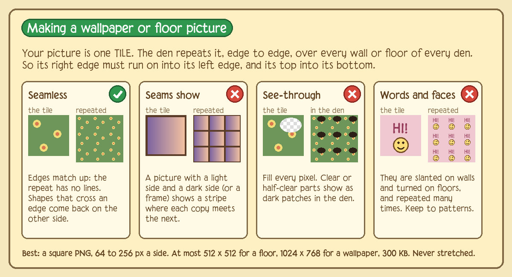
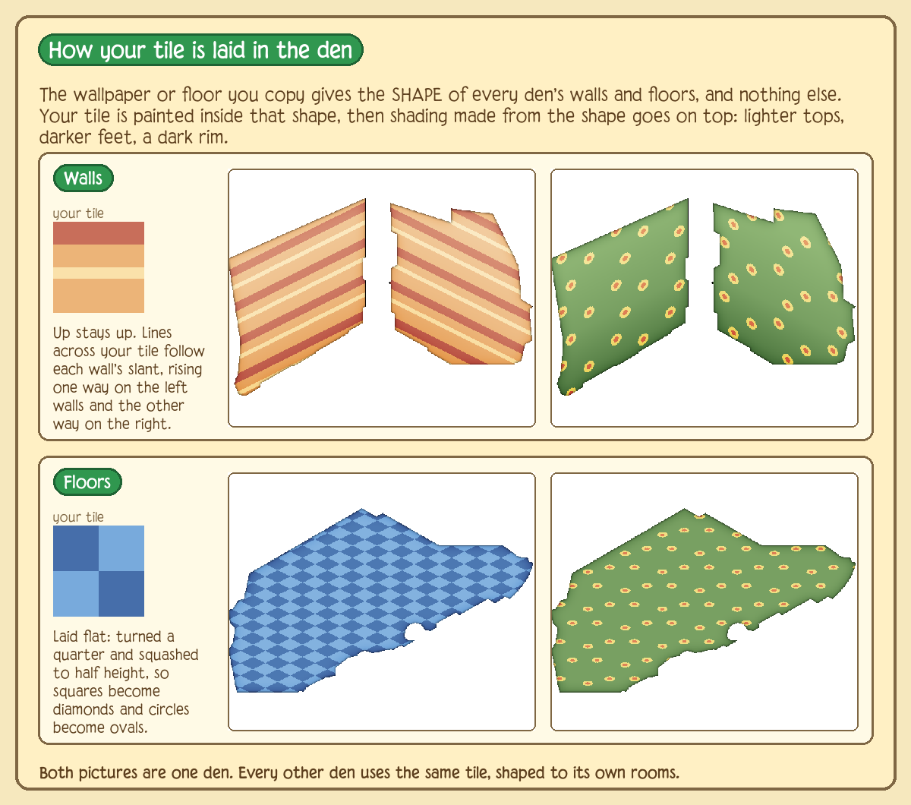
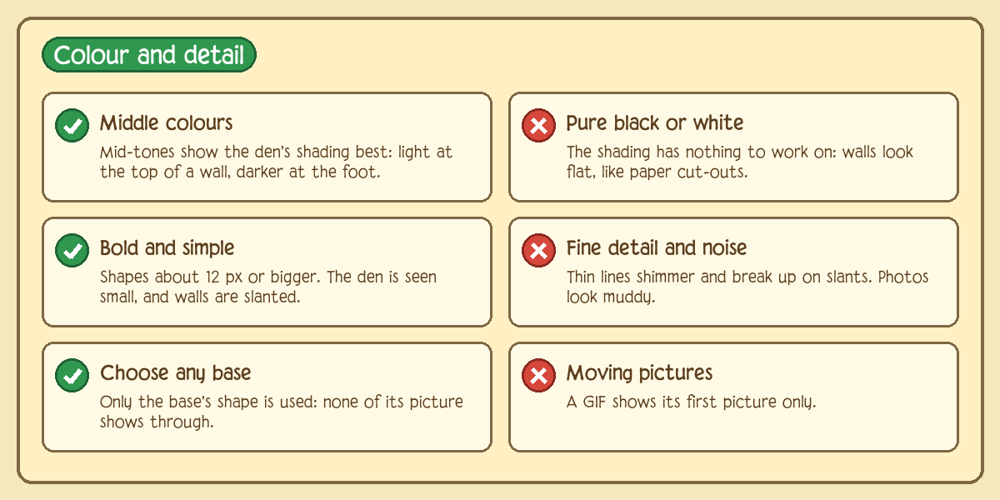
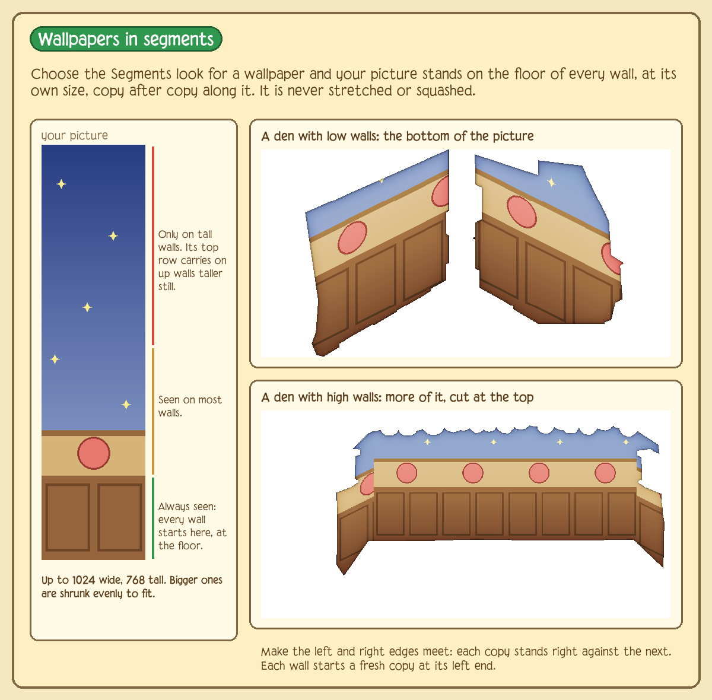

# Custom item pictures: how they are stored, drawn and what to expect

## TL;DR (no technical knowledge needed)

**What is a custom item?** It is a copy of an item that already exists in the game, with a new name, price and,
if you like, your own picture. The copy behaves exactly like the original (a hat is still a hat, a chair is
still a chair). Only the way it looks can change.

**What picture can I use?** A normal image file (PNG is best, because it can have see-through parts). It must be
between 8 and 512 pixels on each side and small in file size (under about 300 KB). Some servers have a
moderator look at new pictures first, and some check them with an automatic filter.

**How does it look in the game?**

- **Clothes, "sticker" look.** Your picture is stuck onto the avatar where the original item would be, like a
  sticker on a T-shirt. It is shrunk or stretched to fit the same space as the original item, and it flips to the
  other side when the avatar turns around (so writing will appear backwards).
- **Clothes, "texture" look.** Your picture is painted *onto the shape of the original item*, like wrapping paper
  on a box. The original item's outline, its dark lines and its shading stay, and your picture's colours fill in
  between. Dark parts of the original are never painted over.
- **Den items (furniture and decorations).** Your picture simply replaces the item. It is shown as a still image,
  standing on the spot where you put it. It won't move, animate, or do anything special.
- **Wallpapers and floors.** One picture fits every den, slanted to match its walls (or laid flat on its floor),
  with light and shade on top made from the shape of the den's walls (none of the base's own picture shows). A wallpaper has two looks: **pattern** (your picture is a *tile*,
  repeated across and down) or **segments** (your picture stands on the floor of each wall at its own size, copy
  after copy along it, cut off at the top of the wall). A floor is a pattern. (The game's own wallpapers are
  neither: each is drawn by hand for every den. A custom one cannot be, so it is fitted to each den instead.)
  See [section 9a](#9a-wallpapers-and-floors-a-guide-for-makers) for what pictures work.
- **Icons.** In your inventory and the shop, the item shows your picture as it is.

**Things to know before you make one:**

1. Pick the original item for its **shape and where it goes**, not for its colours. The picture lives inside
   that shape.
2. The picture is the same for every pose and every animal, but the space it fills changes a little, so it will
   look slightly different in each. Check a few.
3. For the texture look, **dark colours hide your picture**. A black or navy version of the item will show little
   or none of it. Bright colours show the most.
4. Keep pictures **simple and bold**. Tiny details get lost, and texture pictures can look jagged.
5. Den pictures are best around 160 by 160 pixels or smaller, with the object touching the bottom edge of the
   image (that edge is where it sits on the floor).
6. Players can switch off "Custom pictures" in their own settings. They then see the original item instead.
   If something goes wrong with a picture, the game shows the original item rather than breaking.

The rest of this document is the detailed version, for people who want to know exactly how it works or build the
same thing somewhere else.

---

This describes how Dusklight draws an item that has a picture of its own (a PNG uploaded by the item's maker), for
**clothing** (worn on an avatar, in two looks: *sticker* and *texture*) and for **den items**. It is written so
you can reproduce the behaviour in another client or renderer, and so that people making items know which quirks
to design around.

Everything here was read from the source, not measured by running the game. Where something is an inference, it
says so. File references are to this repository.

| Part | File |
|---|---|
| Item records, ids, def rows | `lib/customitems.js` |
| Picture validation, cleaning, storage | `lib/itemart.js` |
| Serving pictures, `crossdomain.xml` | `lib/http.js` (`/itemart/...`, `/crossdomain.xml`) |
| Player maker / approval | `lib/playeritems.js`, `lib/modpanel.js` |
| Optional NSFW scan | `lib/image-moderation.js` |
| Client: loading, caching, URLs | `swf-src/AJClient.as` (`customArtUrl`, `customArtBitmap`, `loadArt`) |
| Client: worn clothing | `swf-src/LayerBitmap.as` (`paintLayer`), `swf-src/LayerAnim.as` |
| Client: icons | `swf-src/Item.as` (`makeSmallIcon`, `makeLargeIcon`) |
| Client: den items | `swf-src/DenItemHelper.as` (`loadCustomArt`), `swf-src/DenItem.as` (icons) |

---

## 1. The model

A custom item is **an existing game item plus overrides**. The record (`custom_items` table) has a `base` (a real
item id below 50000), and its own id (50000 and up), name, price, members flag, colours, shop flag and art.

The server builds the item's definition row as the base's row with the overrides applied (`rowOf`). So everything
not overridden comes from the base: its layer, category, wear rules, footprint, where it can be placed, sort
category, scale and so on. The picture only changes **how the item is drawn**. It does not change what the item
*is*. Choose the base for its behaviour and shape, not for its looks.

Only some bases are allowed:
- Clothing: any clothing piece (not a body part).
- Den items: only "plain" (special type 0) and mannequin (special type 4). Portals, games and similar are refused.

The client learns about custom items in the item packs it downloads, and through an `xdi` message for items made
while it is running. Each row carries `art` (a version string, empty if none) and `artMode` (`sticker` or
`texture`). A row whose picture is waiting for a moderator is not sent at all.

## 2. The picture: upload rules and storage

`lib/itemart.js`, function `check`, then `set`:

1. Accepts **PNG, JPEG, GIF or BMP**, recognised by their bytes, never by file name. Max upload 2 MB. JPEGs
   must be 8-bit baseline or progressive, grey or YCbCr colour: Flash cannot draw CMYK, 12-bit, lossless or
   arithmetic-coded ones, so those are refused.
2. Metadata is stripped. PNG keeps only `IHDR PLTE IDAT IEND tRNS gAMA cHRM sRGB iCCP sBIT pHYs`. JPEG loses
   APP1 to APP15 and comment segments (EXIF, XMP). GIF keeps image blocks, graphic-control blocks and the loop
   block, and loses comments. A BMP (1, 4, 8, 24 or 32 bit, uncompressed or bit fields, up to 4096 px) is converted
   to PNG and, if larger than 512 px, shrunk by box averaging.
3. After cleaning the file must be **300 KB or less**, and each side **8 to 512 px** (a wallpaper's up to 1024 wide and 768 tall, for its segments). Larger PNG/JPEG/GIF are
   rejected, not resized. (The web pages and the in-game maker shrink big pictures before uploading.)
4. Optionally scanned by Google Vision SafeSearch if a key is configured. "Likely" adult or racy is blocked.
   If the scanner is enabled but unreachable, the upload fails closed.
5. A SHA-256 of the cleaned bytes is compared with pictures a moderator previously turned away.
6. Stored as `data/itemart/<kind>-<id>.<png|jpg|gif>`. The item's `art` version is a one-letter type mark plus the
   first 12 hex digits of the SHA-256 (`p…`, `j…`, `g…`). A new picture means a new version, so caches never serve
   an old one.

Approval: player-made items and pictures may be held (`pending` / `artPending`) until a moderator approves. New
accounts can be blocked from adding pictures for `AJ_ITEM_ART_MIN_HOURS` (default 24; 0 turns it off). While a
picture is waiting, `/itemart/...` returns 404 and the client shows the base art.

### Serving

`GET /itemart/<clothing|den>/<id>.png?v=<version>` returns the stored file with the **real** content type
(`image/png`, `image/jpeg` or `image/gif`, whatever the extension in the URL says), with
`Cache-Control: public, max-age=31536000, immutable` and a locked-down Content-Security-Policy. The client appends
`?v=<art>` and encodes it.

`/crossdomain.xml` allows any origin. This matters: the client reads the picture's **pixels** (needed for sticker
and texture), and a Flash `Loader` may only read pixels from another address if that address publishes a policy
file. Without it the client falls back to a loader that can display the picture but not read it.

## 3. Client plumbing (what every renderer needs)

- State per item: `art` version and `artMode`, keyed `"<kind>:<id>"` (`onItemDefs`).
- **Player setting "Custom pictures"** (user variable 9006, 1 = hidden): when hidden, every custom item is drawn
  with its base's art on that player's screen only. All lookups go through `artOf`, which returns nothing in that
  case.
- `customArtUrl(kind, id)` = `<website>/itemart/<kind>/<id>.png?v=<art>`.
- `customArtBitmap(kind, id, waiter)` loads the picture once per `(kind:id, version)` and keeps the BitmapData. If
  it has not arrived yet it returns nothing and registers the waiter; on arrival the waiter repaints.
- `loadArt` (used for clothing icons and emoji) has a small shared cache (400 pictures, then it clears) and queues
  requests for a URL that is already loading.
- Den items fetch the picture's bytes once per address (`DenItemHelper.fetchArtBytes`, 100 pictures, then it
  clears) and decode them into the helper's own `Loader`.
- Failure at any step means the base item's own art is drawn. A broken picture never breaks the item.

## 4. Worn clothing: the sticker look

Code: `LayerBitmap.paintLayer`. This runs **once per layer of the base item, per animation frame, per facing
direction**.

Inputs: the picture `P` (width `pw`, height `ph`), and the layer's frame record `f` with `x, y, w, h` (that
frame's bounding box inside the avatar bitmap, from the base art).

```
left = f.x - bmin.x            top = f.y - bmin.y          // bmin = origin of the avatar bitmap
if flipped: left = (bmax.x - bmin.x) - left - f.w          // mirror the box within the bitmap
s = min(f.w / pw, f.h / ph)                                // fit inside the box; may scale UP
if flipped: matrix = scale(-s, s), translate(left + (f.w + pw*s)/2, top + (f.h - ph*s)/2)
else:       matrix = scale( s, s), translate(left + (f.w - pw*s)/2, top + (f.h - ph*s)/2)
bitmap.draw(P, matrix, smoothing = true)                   // normal alpha blending
```

Properties:
- The **base item's art is not drawn at all.** Only the picture is.
- The picture keeps its aspect ratio, is centred in the frame's box, and is mirrored when the avatar faces the
  other way (so text reads backwards on a flipped avatar).
- It is **not clipped to the item's silhouette**. It is a rectangle (with its own transparency) and cannot go
  outside the box.
- The scale is `min(w/pw, h/ph)` with no upper limit of 1, so a small picture is enlarged to fill the box (smoothed).
- The box changes with pose, animal and animation frame, so the picture's size and position change with them.
  Nothing makes it follow body shape.
- Because it runs per layer, a base item made of several layers will **repeat the picture in each layer's own
  box**. (Inferred from the loop structure; check with a multi-layer base before relying on it.)

## 5. Worn clothing: the texture look

Same entry point, same frame box (`left, top, f.w, f.h`, with the same flip rule). Steps:

1. **Draw the base layer alone** into a scratch bitmap. The scratch is one shared transparent bitmap, at least
   256 x 256 and grown when needed, cleared before each layer. The item is drawn exactly as normal (its colour
   palette is applied here), only into the scratch instead of the avatar bitmap.
2. **Work out the region**: `x0 = max(0, int(left))`, `y0 = max(0, int(top))`, `x1 = min(bitmapWidth, int(left + w))`,
   `y1 = min(bitmapHeight, int(top + h))`.
3. For every pixel `(x, y)` in that region whose alpha is above 0, compute luminance on the 0 to 255 channels:

   ```
   L = (3*R + 6*G + 1*B) / 10
   ```
4. **If `L < 60`, leave the pixel alone.** This is the "outline is kept" rule: dark pixels are never replaced.
5. **Otherwise replace it**:

   ```
   u = (flipped ? (x1 - 1 - x) : (x - x0)) / max(1, x1 - x0)
   v = (y - y0) / max(1, y1 - y0)
   c = P.getPixel32( min(pw-1, int(u * pw)), min(ph-1, int(v * ph)) )       // nearest neighbour, no smoothing
   k = clamp(L / 170, 0.55, 1.15)                                             // keep the item's shading
   R' = min(255, c.R * k)   G' = min(255, c.G * k)   B' = min(255, c.B * k)
   A' = min(itemAlpha, c.A)
   ```
6. Composite the whole scratch bitmap onto the avatar bitmap with alpha merging.

What this means:
- **What survives from the original:** the silhouette and its soft edges (alpha), every pixel darker than 60, and
  the light/dark modelling (folds, shadows, highlights), scaled by `k`.
- **What is replaced:** the colour of all other pixels. Hue and saturation come entirely from the picture. The
  item's own dye matters only through brightness, since it feeds `L`.
- `k` is 0.55 for any `L` up to about 93, rises linearly, and reaches 1.15 at `L` of about 196. So the picture is
  darkened to 55% in shadows and can be up to 15% brighter in highlights. Pure white in the picture only stays
  white where the original was bright.
- The picture is **stretched to the frame box ignoring its aspect ratio**, and the box differs per pose, so
  the stretch differs per pose and animal.
- **Dark dyes eat the picture.** A navy or black colourway has most pixels below `L = 60`, so little or none of
  the picture shows. A bright colourway shows the most. The same item in different colours shows different
  amounts of the picture.
- Nearest-neighbour sampling of a picture up to 512 px into a box that is usually much smaller gives a harsh,
  aliased result. Pictures about the size of the box, with bold shapes, look best.
- **Clamping quirk:** the region is clamped to the bitmap but the mapping is not. If the frame's box hangs off the
  bitmap, the whole picture is squeezed into the visible part and the sample positions are measured from the
  clamped edge (the flip case uses the clamped right edge too).
- Semi-transparent edge pixels that are bright (`L >= 60`) are replaced and keep the lower alpha, so soft edges
  carry the picture colour; dark edge pixels keep their original colour (a dark fringe).

## 6. Caching and repainting (clothing)

- Rendered avatar frames are cached. The cache key of a layer group gets `"|" + id + ":" + art + ":" + artMode`
  added for each custom item with a picture (`customArtKey`), so changing the picture or the look produces a new
  cache entry and other items' caches are untouched.
- If a picture has not loaded when a frame is painted, that frame is painted with the base art and kept. When the
  picture arrives (`artArrived`), every kept frame is marked invalid and repainted. Without that, the picture
  would appear only on frames drawn afterward and flicker through an animation.
- Both look changes (sticker <-> texture) and new pictures reach players already in game via a new `xdi` row.

## 7. Icons (clothing and den)

For a clothing item with a picture the **icon** (inventory, shop, lists) is the picture, not a render of the worn
item: `loadArt(url, sprite, 100, standing = false)`. It is fitted inside a 100 x 100 square, **never enlarged**
(scale `min(1, 100/pw, 100/ph)`), smoothed, centred on the square's middle, then passed to the normal icon
resizer. The icon always shows the plain picture, even for an item that is worn as a texture.

## 8. Den items

Code: `DenItemHelper.loadCustomArt`, called first in `init`, `initDS` and `initGeneric`. If the item has a
picture, the client **does not fetch the base item's file at all**.

The picture's bytes are loaded into the helper's own `Loader` (`loadBytes`), the same place a normal den item's
SWF goes. The icon, shop preview, den and gift code all look for that `Loader`, and now accept a `Bitmap` in it
where they expected a `MovieClip`. A picture that does not load or that Flash cannot decode falls back to the base
item's art.
- Scale `s = min(1, 160/pw, 160/ph)`. The picture is **fitted inside 160 x 160 and never enlarged**. A
  picture under 160 px is shown at its real size.
- Anchor: the picture's top left is on the item's origin, and `contentWidth`/`contentHeight` report its
  scaled size. The den (`DenItemHolder.itemLoaded`) then offsets it by `(-w/2, -h)`, as it does every item, so
  it stands **centred, with its bottom edge on the floor point** where it is placed. So draw the picture with its
  base at the bottom edge and the object centred left to right. Icons are centred on their bounds.
- Smoothed bitmap. Alpha is respected.
- The depth sort offset is set to 0, so it sorts by its origin like a plain item.
- A hit/portal sprite is added so selecting, moving and picking it up still work.
- What is lost compared with a normal den item: animation, the item's versions/states, its flip frame label, and
  anything the base's own SWF did. The picture is static and a single image. A GIF is stored animated by the
  server, but the client takes the picture as a bitmap, which I expect to be its first frame only (untested).
- What is kept from the base: its definition row (category, placement layer, footprint and similar), because those
  come from the server, not the art. Whether a base's scale percentage affects the picture in a den was not
  checked.
- A mannequin base (type 4): the mannequin view is built from the base's loaded SWF, which is skipped here.
  Expect a custom mannequin picture to be only a picture, not a dressable mannequin (not tested).

### 8a. Wallpapers and floors

Code: `DenItemHelper.initDS` and `themeTexture` (and the functions after it). A wallpaper (`sortCat` 3) or floor
(`sortCat` 2) is not one picture: its file is asked for as `defId << 16 | denCatId`, so the CDN sends art drawn
for the den it is in (every room's walls, or floor, in one file). A picture standing in for it the way other den
pictures do would be a 160 px still in the room's corner. So, **in a den only** (`initDS`; shop and inventory
icons still show the plain picture):

1. The base's own file for this den is loaded as ever (`loadBaseArt`). It is the **stencil**. The custom item
   keeps its own id, so the game asks for `items/<custom id << 16 | denCatId>`, which the CDN does not have: the
   server answers every such request with the base's file of the same low number (`customItems.baseFileFor`,
   used in `lib/http.js`). The same goes for a custom den item's icon and a mannequin's poses, and for anyone
   who has "Custom pictures" off.
2. The picture's bytes are fetched (the same cache as other den pictures) and decoded.
3. The base is drawn into a bitmap at full size (a den over 12 million pixels, or 8000 px a side, keeps its base).
4. **Floors:** the picture is tiled over all of it, turned 45 degrees and squashed to half height (the game's
   2:1 floors). **Walls:** the stencil is read at a quarter size, each separate piece of wall is found
   (`floodFill`), and its slant is the median of the slants of its top and bottom edges (columns 5 apart). At
   least 0.3 one way or the other, the whole piece is tiled with `y' = y + 0.5x` or `y' = y - 0.5x`. Nearer
   flat (two walls meeting with no gap, or a wall seen straight on), each column gets its own slant, -0.5, 0 or
   0.5, the most common within 8 columns winning, and runs of one slant are tiled separately.
   **Walls in segments** (the look `segments`, `AJClient.customArtMode`): the same runs, each with its *foot*
   (the median, over its columns, of the lowest wall pixel less the slant, so ragged bits do not move it) and its
   *head* the same way from the top. A run whose head is no more than 64 px under another's foot, with the same
   slant and overlapping by a third of the narrower, is a band of that wall the den's art draws apart (a rail, a
   wainscot): it takes the lower one's foot and its segment origin, so a segment goes up through both
   (`stackRuns`). Each run is then filled with the picture at its own size, not repeated, its bottom on the foot
   line and sheared with the slant, one copy every picture-width from the origin. A copy is not repeated, so
   above the picture its top row carries on up (Flash extends a fill's edges).
5. **Shading** (`themeShade`), from the stencil's **shape only**, never its colours, so none of the base's own
   picture (its planets, stars, plants) shows through as highlights: a grey map laid over the picture with
   `overlay` (128 changes nothing). On walls, each run gets a linear gradient from its head line to its foot line,
   sheared with its slant: 168 at the top, 140 at 60% of the way down, 96 at the foot. A floor is an even 140. Both
   are then multiplied by the outline blurred 24 px, scaled to 55% at the edge and 100% further in, which darkens
   every edge like the game's rims. The base's alpha is then copied in exactly, and a thin inner dark edge (an
   inner `GlowFilter`, 5 px, 45%) drawn. (The first version took the base's brightness, blurred, as the shading:
   its pictures showed through as bright and dark blobs.)
6. The result is a smoothed `Bitmap` at the base's bounds; the base's `Loader` stays (invisible) so that
   anything that reads the item's content still finds it. Anything that fails on the way shows the base.

Known limits: a seam can show where two walls meet with no gap between them; a wall the den draws in two
pieces far apart (more than 64 px) gets a row of segments in each; the base's animation (if any) is
lost; a picture's see-through parts become dark (they take the base's alpha but have no colour); a GIF is its
first frame. The tiles are anchored to the room's coordinates, not to each wall, so they line up along a wall
but a pattern does not start at a wall's corner.

## 9. Design guidance for makers

Clothing:
- Choose the base by **shape and where it sits** (hat, top, shoes). The picture lives inside that base's boxes.
- For **sticker**: PNG with transparency, square-ish or matching the base's proportions, bold and readable at
  small size. Remember it flips on a left-facing avatar and is enlarged to fill the box. Keep a clear margin
  because the box is the limit, not the silhouette.
- For **texture**: use a base with clear dark outlines and smooth shading. Avoid bases that are mostly dark or
  very flat. Choose bright colourways. Use bold, low-detail patterns that survive stretching and nearest-neighbour
  sampling. Expect the pattern to distort between poses.
- Test in the worst colourway and on several animals/poses. Test a left-facing avatar.
- 8 to 512 px per side and under 300 KB. The picture is also the icon, so make sure it reads at 100 px.

Den items:
- Picture at most 160 x 160 for predictable results, anything larger is scaled down to that. Bottom edge is the
  floor contact, so leave no empty margin below the object.
- It is a still image. Do not expect movement or states.

### 9a. Wallpapers and floors: a guide for makers

Make the item in the Item Maker as any den item: pick a wallpaper or floor as the base, then add your picture.
The base only gives the shape of each den's walls (or floor): the shading is made from that shape, and none of
the base's own picture shows. So any wallpaper works for a wallpaper and any floor for a floor (only the ones
with art for each den, which is nearly all of them). For a wallpaper, **Look** switches between *pattern* and *segments* (the
account page and the staff panels have it too).

How tall are the den's walls? Measured on one wallpaper in all 54 dens that have one: walls run from 16 px
(trims, frames) to about 400 px high, and in 33 dens some part of a wall (an arch, a gable, a cave roof) is at
least 1.6 times as high as the rest of it. That is why segments stand on the floor and are cut at the top, and
why a wallpaper's picture may be up to **1024 wide and 768 tall** (any other item's, 512 each way). A bigger one
is shrunk evenly to fit before it is sent, keeping its shape: 2000 x 1000 becomes 1024 x 512, 600 x 900 becomes
512 x 768.









In short:

| | Do | Don't |
|---|---|---|
| Size | A square PNG, **64 to 256 px** a side. It is drawn at its own size and repeated, never stretched. | Over 512 px a side for a floor, 1024 x 768 for a wallpaper, or 300 KB (shrunk to fit when sent from the game or the website; refused otherwise). Very small tiles (under 32 px) repeat so often they read as noise. |
| Edges | **Seamless**: the right edge runs on into the left, the top into the bottom. | Frames, borders, or a light side and a dark side: each copy shows as a block. |
| Pixels | Fill every pixel. | See-through or half-see-through parts: they come out as dark patches. |
| Content | Patterns, small motifs, stripes, checks, textures (wood, brick, grass). | Words, faces, logos, single pictures: they are slanted on walls, turned on floors and repeated. |
| Colour | Mid-tones. The den adds light at the top of walls and shade at the foot and edges. | Pure black or pure white: the shading has nothing to work on. |
| Detail | Bold shapes, about 12 px and up. | Thin lines, noise and photos: they shimmer and break up on slants. |
| Segments | Put what matters at the **bottom**: it is on every wall. Let the top fade into something plain (sky, a colour, a trim), since its top row is stretched up on the tallest walls. Make the left and right edges meet. | Anything important near the top: on low walls it is cut off. |
| On floors | Remember the 45 degree turn and half height: a 128 px tile becomes a diamond about 181 x 90 px. Stripes run corner to corner. | Expecting squares or straight rows across the floor. |

The pictures above were made with the same steps the game uses, on the Planet wallpaper and Grass Carpet floor
of one den, by a script that is not part of the server (so there may be small differences in the game itself).

## 10. Recreating it elsewhere

Server side (any language):
1. Store items as `(kind, id, base, name, cost, members, colours, shop flag, owner, art version, art mode)`;
   ids start at 50000; derive the definition from the base and override the listed fields.
2. Accept uploads by content, strip metadata, cap size at 300 KB and 8 to 512 px, version by hash, serve with
   long immutable caching and the real content type, and allow cross-origin pixel reads if a client needs them.
3. Hold new pictures for approval if you want, and scan them if you can.
4. Send `art` and `artMode` with each item row, and push updates to running clients.

Client side:
1. Per item, load the picture once per version and keep the decoded bitmap; repaint when it arrives.
2. Sticker: scale to fit the layer frame's box (`min(w/pw, h/ph)`), centre, mirror when flipped, draw in place of
   the base art.
3. Texture: render the base layer alone, then for each non-transparent pixel with luminance `(3R+6G+B)/10 >= 60`
   substitute the nearest picture pixel (picture stretched over the frame box, mirrored when flipped), multiply
   by `clamp(L/170, 0.55, 1.15)`, and take `min` of the two alphas.
4. Icons: picture in a 100 px square, never enlarged. Den: picture within 160 px, never enlarged, bottom-centre on
   the item origin, replacing the item's own file.
5. Key any frame cache by `(id, art version, mode)`. Fall back to the base art on any failure and honour a
   per-player option to hide custom pictures.
